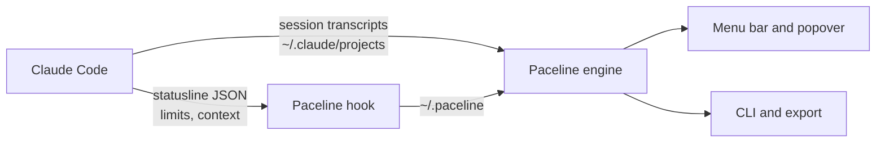

<p align="center">
  
</p>

<h1 align="center">Paceline</h1>

<p align="center">
  <strong>Hold your pace. Know before you hit the limit.</strong><br>
  A macOS menu bar app that shows your Claude usage limits, when you will reach them at your current pace, and which projects are spending the quota.
</p>

<p align="center">
  
  
  
  
</p>


<p align="center"><sub>Screenshot uses generated demo data.</sub></p>

## Why

The 5-hour and weekly limits are easy to forget until a session stops mid-task. A percentage tells you where you are. Paceline also tells you where you are heading: *"Limit at 10:02, 1h 20m before reset"* is a different message from *"64%"*.

It reads only files that are already on your Mac. No API key, no OAuth token, no cookies, no network calls.

## What you get

| | |
|---|---|
| **Live limits** | The real 5-hour and weekly percentages, as Claude Code reports them, with reset countdowns. |
| **Pace forecast** | When you will hit each limit at the current pace, or where you will land at reset. The pace cools down while you are idle. |
| **Pace mark** | A tick on every bar showing how much of the window has elapsed. A bar past the tick is ahead of an even pace. |
| **Model mix** | How much of the current week went to Fable, Opus, Sonnet and Haiku. |
| **Cost per project** | Tokens and API-equivalent cost by project, model, session and day, for today, 7 days or 30 days. |
| **Context meter** | How full the context window is in each active Claude Code session. |
| **Alerts** | Notifications at 50, 75 and 90% (configurable), plus one warning per window when the forecast says you will run out early. |
| **CLI and export** | The same numbers as terminal tables, JSON or CSV. |

It also opens at login, follows light and dark mode, and is built to open over full-screen apps and on whichever display you click.

## Install

Builds are not signed or notarized yet, so for now Paceline is installed from source. You need macOS 11 or later, the Xcode Command Line Tools and Rust 1.82 or later.

```bash
git clone https://github.com/reginaldosilva27/paceline.git
cd paceline
cargo install tauri-cli --version "^2" --locked
cargo tauri build
cp -R "target/release/bundle/macos/Paceline.app" /Applications/
open /Applications/Paceline.app
```

Then:

1. Click the menu bar item and choose **Enable live limits**.
2. Send any message in Claude Code. The percentages appear within a few seconds.
3. Open Settings and turn on **Open at login**.

To keep the item in the always-visible part of the menu bar, hold Command and drag it where you want it.

## How it works



| Source | What it provides |
|---|---|
| Session transcripts in `~/.claude/projects` | Tokens, models, projects and sessions. Entries are deduplicated by message and request id. |
| Claude Code statusline | The real 5-hour and weekly percentages, reset times, and the context window of each session. Available on Pro and Max plans, after the first response in a session. |

**The hook.** Claude Code passes a JSON document to whatever command is configured as its statusline. Paceline registers itself there, saves the numbers, and prints a short status line. If you already have a statusline, it is kept: Paceline records the data and then runs your original command, so your terminal looks the same. A backup of `~/.claude/settings.json` is written next to it, and removing the hook restores the original.

**Freshness.** The limits are account-wide, so usage from the desktop app and claude.ai counts toward the percentages. They refresh whenever a Claude Code session is active. Without the hook, Paceline still shows tokens, cost and an estimated 5-hour window.

**Cost.** Costs are API-equivalent: what the same tokens would cost at API list prices. A subscription is not billed per token. The price table lives in `crates/core/src/pricing.json` and can be overridden in the config.

**Per-model limits.** The statusline reports one 5-hour and one weekly percentage for the account, with no separate limit per model. Paceline therefore shows the model mix (each family's share of the week, by API-equivalent cost) and not a per-model percentage. If Claude Code starts reporting more windows, they appear in the panel automatically.

## CLI

The app binary doubles as the CLI:

```bash
alias paceline="/Applications/Paceline.app/Contents/MacOS/paceline"
```

```text
paceline status                      limits, forecast, burn rate, today
paceline projects --days 30          cost per project
paceline daily --days 7              cost per day
paceline models --days 7             cost per model
paceline sessions                    context window of recent sessions
paceline export --days 30            full JSON document
paceline export --format csv --by project|day|model|session
paceline hook install|uninstall|status
```

`status`, `projects`, `daily`, `models` and `sessions` accept `--json`.

```text
5-hour  █████████████░░░░░░░  64.0%   resets in 2h 10m (Fri 11:22)
        at this pace: limit Fri 10:02 (1h 20m before reset)
weekly  ████████░░░░░░░░░░░░  38.5%   resets in 3d 1h (Mon 10:12)
        at this pace: 68% at reset
        this week by model (share of API-equivalent cost): Fable 83% · Sonnet 9% · Opus 8%
```

For a standalone binary without the app, run `cargo install --path crates/cli`. It installs `paceline-cli`.

## Configuration

`~/.paceline/config.json`, also editable from the app's Settings:

```json
{
  "thresholds": [50, 75, 90],
  "forecast_alerts": true,
  "notifications": true,
  "refresh_secs": 30,
  "menu_bar": "both",
  "pricing_overrides": []
}
```

`menu_bar` is one of `both`, `five_hour`, `seven_day` or `icon_only`. The environment variables `CLAUDE_CONFIG_DIR` (comma-separated) and `PACELINE_HOME` override the default directories.

## Privacy

Paceline makes no network requests. It reads Claude Code's transcripts for token counts and metadata, never stores message content, and keeps its own state in `~/.paceline`. It does not read your Claude credentials.

## Where it fits

This is a crowded space, and several projects are worth a look: [CodexBar](https://github.com/steipete/CodexBar) covers dozens of providers, [tokenmeter](https://github.com/Priyans-hu/tokenmeter) reads limits through the OAuth token, [ccusage](https://github.com/ryoppippi/ccusage) is the reference CLI for cost reports, and [Headroom](https://github.com/patwalls/headroom) uses the same statusline approach.

Paceline's focus is narrower: Claude only, local data only, and a forecast for both windows next to cost per project and context per session in one popover.

## Development

```text
crates/core   engine: transcripts, pricing, limits store, forecast, alerts, hook installer
crates/cli    command line (also embedded in the app)
src-tauri     menu bar shell: tray item, popover window, notifications
ui            popover in plain HTML, CSS and JS, with no build step
```

```bash
cargo test                  # engine and CLI, no GUI dependencies
cargo tauri dev             # run the app from source
```

## Status

Version 0.1, early but in daily use.

- Engine and CLI are covered by 56 unit tests, plus an end-to-end run against generated transcripts with totals cross-checked by an independent script.
- The menu bar item, popover and live limits are confirmed working on Apple Silicon.
- Lightly tested so far: notifications, open at login, multi-display placement, and wrapping an existing statusline. Please open an issue if one misbehaves.

## Roadmap

- Signed and notarized builds, then a Homebrew cask.
- File watching in place of polling.
- Opt-in OAuth usage endpoint, for limits without a running Claude Code session and for per-model percentages.
- Budget alerts per project.

## License

MIT. Paceline is an independent project and is not affiliated with or endorsed by Anthropic. Claude is a trademark of Anthropic.
