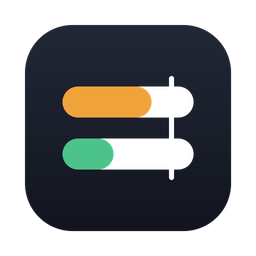
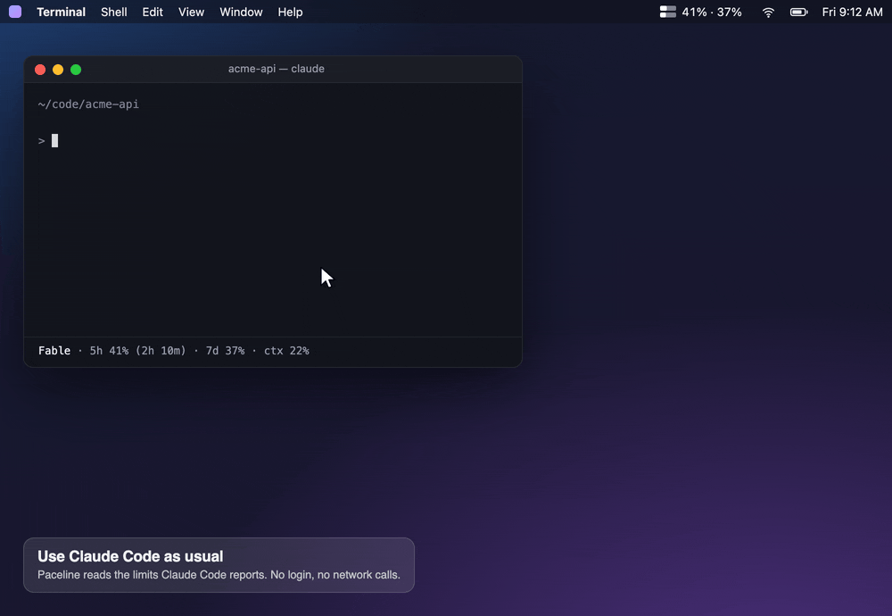
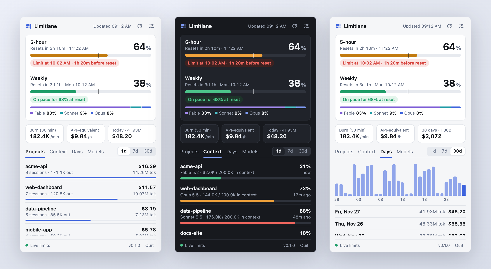
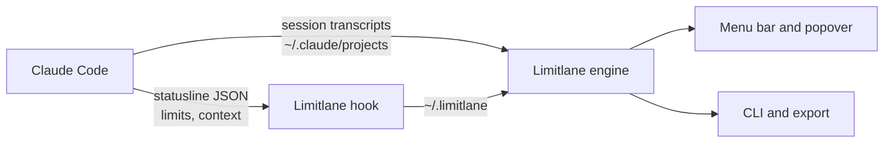

<p align="center">
  
</p>

<h1 align="center">Limitlane</h1>

<p align="center">
  <strong>Hold your pace. Know before you hit the limit.</strong><br>
  A menu bar app for macOS and Windows that shows your Claude usage limits, when you will reach them at your current pace, and which projects are spending the quota.
</p>

<p align="center">
  
  
  
  
  
</p>

<p align="center">
  
</p>

<p align="center"><sub>Animation and screenshot use generated demo data.</sub></p>

## Install

**macOS** 11 or later, Apple Silicon or Intel. In Terminal:

```bash
curl -fsSL https://raw.githubusercontent.com/reginaldosilva27/limitlane/main/install.sh | bash
```

**Windows** 10 or 11. In PowerShell:

```powershell
irm https://raw.githubusercontent.com/reginaldosilva27/limitlane/main/install.ps1 | iex
```

Each command downloads the latest [release](https://github.com/reginaldosilva27/limitlane/releases), installs it and opens it. On macOS the app goes to `/Applications` (or `~/Applications` without admin rights). On Windows it installs for the current user, with no administrator prompt.

The builds are not signed with an Apple or Microsoft certificate yet. Files downloaded by `curl` and PowerShell are not marked as coming from the internet, so the commands above should open the app without the "unidentified developer" or SmartScreen prompts that a browser download triggers. The scripts are short; read [install.sh](install.sh) and [install.ps1](install.ps1) before running them if you prefer.

### Ask Claude to install it

In Claude Code, or any assistant that can run commands on your computer, paste:

```text
Install Limitlane from https://github.com/reginaldosilva27/limitlane and enable its live limits.
```

It will run the installer for your system and then turn on the statusline hook. The Windows commands below work from both Git Bash and PowerShell, the two shells Claude Code uses there:

| | Install | Enable live limits |
|---|---|---|
| macOS | the `curl` command above | `/Applications/Limitlane.app/Contents/MacOS/limitlane hook install` |
| Windows | `powershell -NoProfile -Command "irm https://raw.githubusercontent.com/reginaldosilva27/limitlane/main/install.ps1 \| iex"` | `~/AppData/Local/Limitlane/limitlane-cli.exe hook install` |

### First run

1. Click the Limitlane item and choose **Enable live limits** (or use the command above). On macOS the item is in the menu bar; on Windows it is in the notification area next to the clock, possibly under the **^** overflow arrow.
2. Send any message in Claude Code. The percentages appear within a few seconds.
3. Open Settings and turn on **Open at login**.

To keep the item visible, on macOS hold Command and drag it where you want it in the menu bar; on Windows drag it from the overflow onto the taskbar. Windows shows no text next to tray icons, so there the icon's two bars are coloured by level and the percentages are in its tooltip.

### Uninstall

```bash
curl -fsSL https://raw.githubusercontent.com/reginaldosilva27/limitlane/main/install.sh | bash -s -- --uninstall
```

```powershell
& ([scriptblock]::Create((irm https://raw.githubusercontent.com/reginaldosilva27/limitlane/main/install.ps1))) -Uninstall
```

Both remove the statusline hook first, restoring the statusline you had before, then the app and its login item. Settings and limit history stay in `~/.limitlane`.

### Build from source

You need Rust 1.82 or later and the Tauri CLI (`cargo install tauri-cli --version "^2" --locked`), plus the Xcode Command Line Tools on macOS, or the Visual Studio C++ build tools on Windows (WebView2 ships with Windows 10 and 11).

```bash
git clone https://github.com/reginaldosilva27/limitlane.git
cd limitlane
cargo tauri build                     # on Windows: cargo tauri build --features cli-exe
```

On macOS this produces `target/release/bundle/macos/Limitlane.app` (copy it to `/Applications`) and a disk image; on Windows, a setup program in `target/release/bundle/nsis/`.

## Why

The 5-hour and weekly limits are easy to forget until a session stops mid-task. A percentage tells you where you are. Limitlane also tells you where you are heading: *"Limit at 10:02, 1h 20m before reset"* is a different message from *"64%"*.

It reads only files that are already on your computer. No API key, no OAuth token, no cookies, no network calls.

## What you get

| | |
|---|---|
| **Live limits** | The real 5-hour and weekly percentages, as Claude Code reports them, with reset countdowns. |
| **Pace forecast** | When you will hit each limit at the current pace, or where you will land at reset. The pace cools down while you are idle. |
| **Pace mark** | A tick on every bar showing how much of the window has elapsed. A bar past the tick is ahead of an even pace. |
| **Model mix** | How much of the current week went to Fable, Opus, Sonnet and Haiku. |
| **Cost per project** | Tokens and API-equivalent cost by project, model, session and day, for today, 7 days or 30 days. |
| **Context meter** | How full the context window is in each active Claude Code session. |
| **Alerts** | Notifications at 50, 75 and 90% (configurable), plus one warning per window when the forecast says you will run out early. |
| **CLI and export** | The same numbers as terminal tables, JSON or CSV. |

It also opens at login, follows light and dark mode, and is built to open over full-screen apps and on whichever display you click.



## How it works



| Source | What it provides |
|---|---|
| Session transcripts in `~/.claude/projects` | Tokens, models, projects and sessions. Entries are deduplicated by message and request id. |
| Claude Code statusline | The real 5-hour and weekly percentages, reset times, and the context window of each session. Available on Pro and Max plans, after the first response in a session. |

**The hook.** Claude Code passes a JSON document to whatever command is configured as its statusline. Limitlane registers itself there, saves the numbers, and prints a short status line. If you already have a statusline, it is kept: Limitlane records the data and then runs your original command, so your terminal looks the same. A backup of `~/.claude/settings.json` is written next to it, and removing the hook restores the original. On Windows, where Claude Code runs the statusline through Git Bash or, without it, PowerShell, the hook runs `limitlane-cli.exe`, a console program installed next to the app (PowerShell does not wait for GUI programs), written in a form both shells accept (`~/AppData/Local/Limitlane/limitlane-cli.exe ...`).

**Freshness.** The limits are account-wide, so usage from the desktop app and claude.ai counts toward the percentages. They refresh whenever a Claude Code session is active. Without the hook, Limitlane still shows tokens, cost and an estimated 5-hour window.

**Cost.** Costs are API-equivalent: what the same tokens would cost at API list prices. A subscription is not billed per token. The price table lives in `crates/core/src/pricing.json` and can be overridden in the config.

**Per-model limits.** The statusline reports one 5-hour and one weekly percentage for the account, with no separate limit per model. Limitlane therefore shows the model mix (each family's share of the week, by API-equivalent cost) and not a per-model percentage. If Claude Code starts reporting more windows, they appear in the panel automatically.

## CLI

The app binary doubles as the CLI; on Windows use `limitlane-cli.exe`, installed next to it:

```bash
alias limitlane="/Applications/Limitlane.app/Contents/MacOS/limitlane"        # macOS
```

```powershell
Set-Alias limitlane "$env:LOCALAPPDATA\Limitlane\limitlane-cli.exe"            # Windows
```

```text
limitlane status                      limits, forecast, burn rate, today
limitlane projects --days 30          cost per project
limitlane daily --days 7              cost per day
limitlane models --days 7             cost per model
limitlane sessions                    context window of recent sessions
limitlane export --days 30            full JSON document
limitlane export --format csv --by project|day|model|session
limitlane hook install|uninstall|status
```

`status`, `projects`, `daily`, `models` and `sessions` accept `--json`.

```text
5-hour  █████████████░░░░░░░  64.0%   resets in 2h 10m (Fri 11:22)
        at this pace: limit Fri 10:02 (1h 20m before reset)
weekly  ████████░░░░░░░░░░░░  38.5%   resets in 3d 1h (Mon 10:12)
        at this pace: 68% at reset
        this week by model (share of API-equivalent cost): Fable 83% · Sonnet 9% · Opus 8%
```

For a standalone binary without the app, run `cargo install --path crates/cli`. It installs `limitlane-cli`.

## Configuration

`~/.limitlane/config.json` (`%USERPROFILE%\.limitlane\config.json` on Windows), also editable from the app's Settings:

```json
{
  "thresholds": [50, 75, 90],
  "forecast_alerts": true,
  "notifications": true,
  "refresh_secs": 30,
  "menu_bar": "both",
  "pricing_overrides": []
}
```

`menu_bar` is one of `both`, `five_hour`, `seven_day` or `icon_only`, and applies to macOS only. The environment variables `CLAUDE_CONFIG_DIR` (comma-separated) and `LIMITLANE_HOME` override the default directories.

## Privacy

Limitlane makes no network requests. It reads Claude Code's transcripts for token counts and metadata, never stores message content, and keeps its own state in `~/.limitlane`. It does not read your Claude credentials.

## Where it fits

This is a crowded space, and several projects are worth a look: [CodexBar](https://github.com/steipete/CodexBar) covers dozens of providers, [tokenmeter](https://github.com/Priyans-hu/tokenmeter) reads limits through the OAuth token, [ccusage](https://github.com/ryoppippi/ccusage) is the reference CLI for cost reports, and [Headroom](https://github.com/patwalls/headroom) uses the same statusline approach.

Limitlane's focus is narrower: Claude only, local data only, and a forecast for both windows next to cost per project and context per session in one popover.

## Development

```text
crates/core     engine: transcripts, pricing, limits store, forecast, alerts, hook installer
crates/cli      command line (also embedded in the app)
src-tauri       menu bar shell: tray item, popover window, notifications
ui              popover in plain HTML, CSS and JS, with no build step
install.sh      macOS installer;  install.ps1  Windows installer
scripts/demo    records docs/demo.gif from the real popover with demo data
```

```bash
cargo test -p limitlane-core -p limitlane-cli   # engine and CLI, no GUI dependencies
cargo tauri dev                               # run the app from source
cd scripts/demo && npm install && node record.mjs   # re-record the GIF (needs gifski)
```

**Releasing.** Bump the version in `Cargo.toml` and `src-tauri/tauri.conf.json`, then push a tag such as `v0.2.0`. The Release workflow builds the universal macOS disk image and the Windows setup program, installs each one with its install script on a clean runner, exercises the hook (through Git Bash and PowerShell on Windows), uninstalls, and only then publishes the release the install scripts download from. Pull requests that touch the app run the same jobs without publishing.

## Status

Version 0.1, early but in daily use on macOS. Windows support is new.

- Engine and CLI are covered by 63 unit tests, run on macOS, Windows and Linux in CI, plus an end-to-end run against generated transcripts with totals cross-checked by an independent script.
- The menu bar item, popover and live limits are confirmed working on Apple Silicon.
- Windows is checked in CI only so far. Before a release is published, the release workflow installs the build on a clean Windows runner (through `irm | iex` in Windows PowerShell 5.1 and again with PowerShell 7), runs the hook through Git Bash and PowerShell, checks that an existing statusline keeps working, and uninstalls. The tray icon, popover placement above the taskbar, notifications and open at login have not yet been tried on a real Windows desktop. Please open an issue with what you see.
- Lightly tested so far on macOS: notifications, open at login, multi-display placement, and wrapping an existing statusline. Please open an issue if one misbehaves.

## Roadmap

- Signed and notarized builds, then a Homebrew cask and a winget package.
- File watching in place of polling.
- Opt-in OAuth usage endpoint, for limits without a running Claude Code session and for per-model percentages.
- Budget alerts per project.

## License

MIT. Limitlane is an independent project and is not affiliated with or endorsed by Anthropic. Claude is a trademark of Anthropic.
